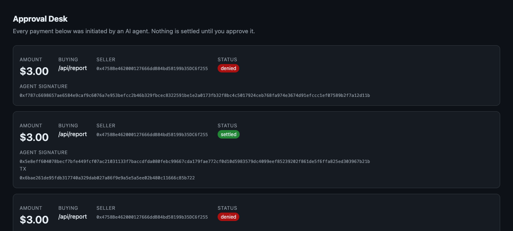

# Paydlux — spend-limited payments for AI agents

AI agents are starting to buy things (APIs, data, compute) over HTTP with
stablecoin payments ([x402](https://x402.org)). Today an agent gets a raw
crypto wallet: **no spending cap, no human approval, no refund path** — and
real money has already been drained this way.

Paydlux puts the guardrails **on-chain**:

- **Mandates** — a human registers a spending rule set (max per call, per day,
  total, payee allowlist, expiry). The agent's key can *never* exceed it, even
  if the agent is compromised or prompt-injected.
- **Request-bound signatures** — every payment proof is bound to the exact
  HTTP request it pays for. Captured proofs cannot be replayed or pointed at
  other resources (the "floating authorization" class from
  [arXiv:2605.30998](https://arxiv.org/abs/2605.30998) — our fuzz tests prove
  substitution reverts).
- **Human-in-the-loop approval** — mandates can require a person to sign the
  *exact* payment before it settles. The Approval Desk shows what the agent
  wants to buy; nothing moves until a human approves. Approvals are
  single-use and payment-bound.
- **Escrow with proof-of-delivery** — funds are held until the seller signs a
  delivery receipt binding the paid content hash; otherwise the buyer reclaims.
- **Batched settlement** — tokenized credits + Merkle batches amortize gas to
  ~$0.00005/payment, making sub-cent agent micropayments viable.

## Status

Research prototype. 61 contract tests pass (incl. 4×512-run fuzz suites over
the core invariants). End-to-end demos run against a local anvil chain; the
deploy script is verified against a live Base Sepolia fork.
**Not audited. Do not use with real funds.**

The Approval Desk — what a human sees when an agent wants to spend:



```
contracts/src/AgentVault.sol      vault, mandates, settle, escrow, sessions, batches
contracts/src/AgentCreditToken.sol  USDC-backed credit token (deferred settlement)
contracts/src/MockUSDC.sol        testnet faucet token (anyone can mint)
contracts/script/Deploy.s.sol     full-stack testnet deploy (Base Sepolia)
sdk/core.ts                       EIP-712 typed data (mirrors the contract exactly)
sdk/gateway.ts                    x402-style HTTP 402 resource server
sdk/client.ts                     paying agent client
sdk/approval.ts                   human-in-the-loop Approval Desk (web UI + wallet signing)
sdk/demo.ts                       full loop: deposit → mandate → 402 → settle → escrow
sdk/demo-approval.ts              agent buys, human approves on a web page, then it settles
sdk/economics.ts                  unit economics from measured gas + live prices
```

## Quick start

```bash
# prerequisites: node >= 22 (native TS), foundry (forge)
anvil --chain-id 31337 &                      # local chain
cd contracts && forge build && forge test     # 61 tests
cd ../sdk && npm i                            # viem
node demo.ts                                  # full payment loop
node demo-approval.ts                         # human-approval loop, portal on :4022
```

## How a payment works

1. Agent `GET`s a priced resource → gateway answers `402 Payment Required`.
2. Agent signs an EIP-712 `PaymentIntent` bound to that exact request
   (method, URI, body hash, nonce) with its mandate key.
3. Gateway verifies the proof against the on-chain mandate (agent identity,
   caps, window, replay) and calls `settle`.
4. The contract re-checks everything, enforces per-call / daily / total
   budgets, charges the fee, and pays in credits.

With approval required, step 3 holds the verified payment in the Approval
Desk; the human signs the same intent digest (MetaMask `personal_sign` works);
`settleWithApproval` releases it. A denial settles nothing.

## Economics (measured, Base mainnet gas)

Settlement costs ~$0.0013 direct, ~$0.0005 batched per payment. At x402's
~$0.30 average call value, per-transaction fees alone don't fund a company —
the model is SaaS (mandate management, dashboards, compliance evidence) plus
small bps. `sdk/economics.ts` prints the full model with live prices.

## License

MIT
